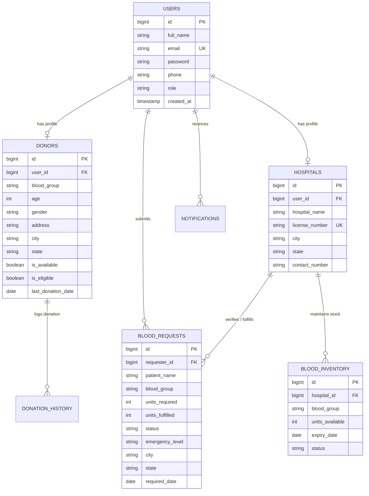

# Smart Blood Donation Network 🩸

A complete full-stack web application designed to connect blood donors, emergency patients, and hospitals in real-time. Built with **Java 21**, **Spring Boot 3**, **Spring Security 6 (JWT)**, **React.js (Vite)**, **MySQL 8.0**, and containerized with **Docker & Docker Compose**.

---

## 🌟 Key Features

### 🔐 1. Authentication & Security
- **JWT-Based Authentication**: Secure stateless token authentication.
- **Role-Based Access Control (RBAC)**: Dedicated permissions for `ROLE_ADMIN`, `ROLE_DONOR`, and `ROLE_HOSPITAL`.
- **BCrypt Encryption**: Secure password hashing.

### 🩸 2. Donor Module
- **Donor Registration & Profile**: Blood group, age, gender, location, and 90-day donation eligibility tracking.
- **Availability Toggle**: Mark oneself available/unavailable for emergency calls.
- **Donation History**: Log past donations and track next eligible donation date.
- **Interactive Donor Search**: Filter active donors by Blood Group, City, State, and Availability.

### 🚑 3. Blood Request & Emergency Workflow
- **Emergency Requests**: Tag requests with priority levels (`LOW`, `MEDIUM`, `HIGH`, `CRITICAL`).
- **Hospital Approval & Fulfillment**: Verification workflow allowing hospitals to approve and fulfill requests.
- **Status Tracking**: Track request states (`PENDING`, `APPROVED`, `FULFILLED`, `CANCELLED`).

### 📦 4. Central Blood Inventory & Alerts
- **Stock Grid Matrix**: Monitor stock across all 8 blood groups (`A+`, `A-`, `B+`, `B-`, `AB+`, `AB-`, `O+`, `O-`).
- **Low Stock Alerts**: Visual warning indicators when units drop below critical thresholds (< 5 units).

### 📊 5. Role-Tailored Dashboards
- **Admin Dashboard**: System metrics, total donors, hospital count, global stock matrix, user management.
- **Donor Dashboard**: Profile completion percentage, eligibility countdown, nearby matching requests.
- **Hospital Dashboard**: Active request queue, inventory stock control, approved request history.

### 📅 6. Donation Camps & Notifications
- **Community Drives**: Discover upcoming donation camps or schedule new events.
- **Notification Feed**: Real-time notifications for request updates and eligibility alerts.

---

## 🛠️ Tech Stack

| Layer | Technology |
| :--- | :--- |
| **Backend** | Java 21, Spring Boot 3.2.3, Spring Security 6, Spring Data JPA, Hibernate |
| **Frontend** | React 18, Vite, React Router v6, Axios, Lucide Icons, Custom CSS System |
| **Database** | MySQL 8.0 |
| **Security** | JWT (JSON Web Token), BCrypt Encoder |
| **API Docs** | Swagger / OpenAPI 3.0 (`springdoc-openapi-starter-webmvc-ui`) |
| **Containerization** | Docker, Docker Compose, Nginx Alpine |
| **Build Tool** | Maven 3.9+, Node.js 18+ / npm |

---

## 📐 Database Architecture & ER Diagram



---

## 🔑 Pre-seeded Demo Accounts

For instant out-of-the-box testing, the application pre-seeds the following accounts (Password: `password123`):

| Role | Email | Password |
| :--- | :--- | :--- |
| **Admin** | `admin@smartblood.org` | `password123` |
| **Hospital** | `cityhospital@smartblood.org` | `password123` |
| **Donor** | `john.donor@smartblood.org` | `password123` |

---

## 🚀 Quick Start & Installation

### Option 1: Running with Docker Compose (Recommended)

1. Clone the repository:
   ```bash
   git clone <repository-url>
   cd blood
   ```

2. Launch all services with Docker Compose:
   ```bash
   docker-compose up --build -d
   ```

3. Access the application:
   - **Frontend App**: `http://localhost:3000`
   - **Backend REST API**: `http://localhost:8080`
   - **Swagger OpenAPI Docs**: `http://localhost:8080/swagger-ui.html`

---

### Option 2: Local Development Setup (Without Docker)

#### Prerequisites
- Java 21 installed
- Maven installed
- Node.js (v18+) & npm installed
- MySQL 8.0 running locally on port 3306

#### Step 1: Database Setup
Create MySQL database:
```sql
CREATE DATABASE blood_donation_db;
```

#### Step 2: Start Spring Boot Backend
```bash
cd backend
mvn clean spring-boot:run
```
*(The backend starts on port 8080 and automatically initializes tables and seed data).*

#### Step 3: Start React Frontend
```bash
cd frontend
npm install
npm run dev
```
*(The frontend starts on `http://localhost:3000`).*

---

## 📖 REST API Endpoints Overview

| Method | Endpoint | Description | Access |
| :--- | :--- | :--- | :--- |
| `POST` | `/api/v1/auth/login` | Authenticate user & get JWT token | Public |
| `POST` | `/api/v1/auth/register` | Register new Donor or Hospital | Public |
| `GET` | `/api/v1/auth/me` | Fetch authenticated user context | Authenticated |
| `GET` | `/api/v1/donors/search` | Search eligible donors with filters | Public |
| `GET` | `/api/v1/donors/profile` | Fetch donor profile | Donor / Admin |
| `PUT` | `/api/v1/donors/profile` | Update donor profile & availability | Donor / Admin |
| `GET` | `/api/v1/blood-requests` | List blood requests | Public |
| `POST` | `/api/v1/blood-requests` | Submit emergency blood request | Authenticated |
| `PUT` | `/api/v1/blood-requests/{id}/status` | Update request status | Hospital / Admin |
| `GET` | `/api/v1/inventory` | View blood stock inventory | Public |
| `POST` | `/api/v1/inventory` | Add/Update inventory stock level | Hospital / Admin |
| `GET` | `/api/v1/dashboard/admin` | Fetch Admin stats & metrics | Admin |
| `GET` | `/api/v1/dashboard/donor` | Fetch Donor dashboard & countdown | Donor |
| `GET` | `/api/v1/dashboard/hospital` | Fetch Hospital active request queues | Hospital |

---

## 🖼️ Application Screenshots Placeholders

| Home Page Hero | Donor Search & Filters |
| :---: | :---: |
| *[Screenshot: Glassmorphic Hero Banner & Live Stock Ticker]* | *[Screenshot: Interactive Donor Search Grid]* |

| Dashboard Analytics | Blood Inventory Control |
| :---: | :---: |
| *[Screenshot: Role-customized Dashboard Stats Cards]* | *[Screenshot: Stock Level Progress Indicators]* |

---

## 📂 Project Directory Structure

```
blood/
├── backend/
│   ├── Dockerfile
│   ├── pom.xml
│   └── src/
│       └── main/
│           ├── java/com/smartblood/
│           │   ├── SmartBloodApplication.java
│           │   ├── config/ (SecurityConfig, CorsConfig, SwaggerConfig, DataInitializer)
│           │   ├── controller/ (Auth, Donor, Hospital, BloodRequest, Inventory, Admin, Camp, Notification)
│           │   ├── dto/ (AuthDTOs, DonorDTOs, RequestDTOs, InventoryDTOs, DashboardDTOs)
│           │   ├── entity/ (User, Role, Donor, Hospital, BloodRequest, BloodInventory, DonationHistory, DonationCamp, Notification)
│           │   ├── exception/ (GlobalExceptionHandler, ResourceNotFoundException)
│           │   ├── repository/ (Repositories)
│           │   ├── security/ (JwtUtils, JwtAuthFilter, CustomUserDetails, UserDetailsServiceImpl)
│           │   └── service/ (Services)
│           └── resources/
│               ├── application.yml
│               ├── schema.sql
│               └── data.sql
├── frontend/
│   ├── Dockerfile
│   ├── nginx.conf
│   ├── package.json
│   ├── vite.config.js
│   └── src/
│       ├── App.jsx
│       ├── main.jsx
│       ├── index.css
│       ├── api/ (axiosClient)
│       ├── components/ (Navbar, Footer, ProtectedRoute, Modal, StatsCard)
│       ├── context/ (AuthContext, ThemeContext)
│       └── pages/ (Home, Login, Register, Dashboard, DonorSearch, BloodRequests, Inventory, Profile, Camps, AdminPanel)
├── docker-compose.yml
├── README.md
└── .gitignore
```

---

## 🔮 Future Enhancements
- 📲 **SMS & WhatsApp Alerts**: Integration with Twilio for instant SMS dispatch on emergency blood requests.
- 🗺️ **GPS Geo-Fencing**: Live map distance calculation between donor home address and requesting hospital.
- 🩸 **Blood Bank RFID Tracking**: Integration with hardware RFID scanning for individual blood bag batch management.
